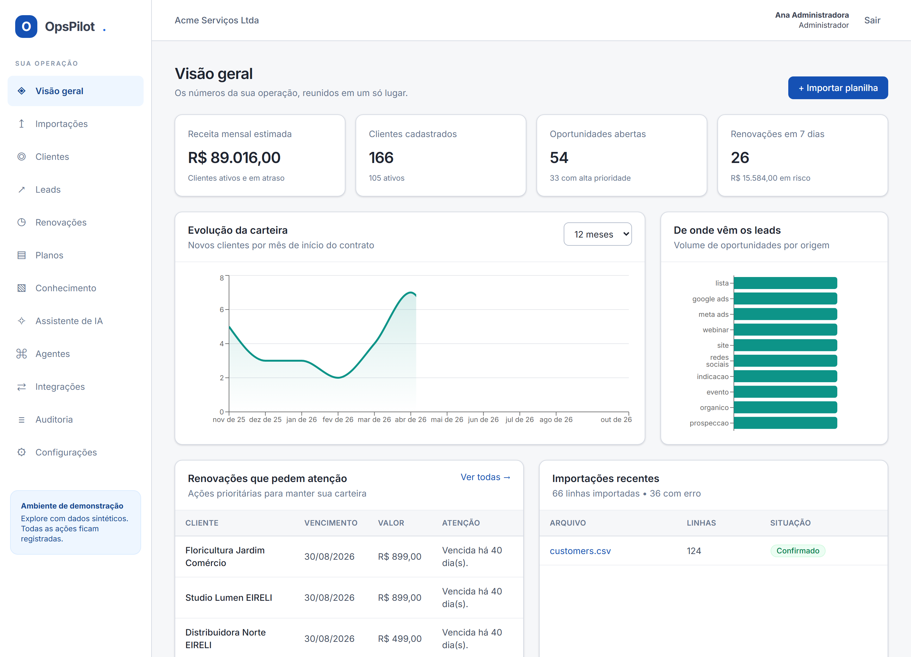
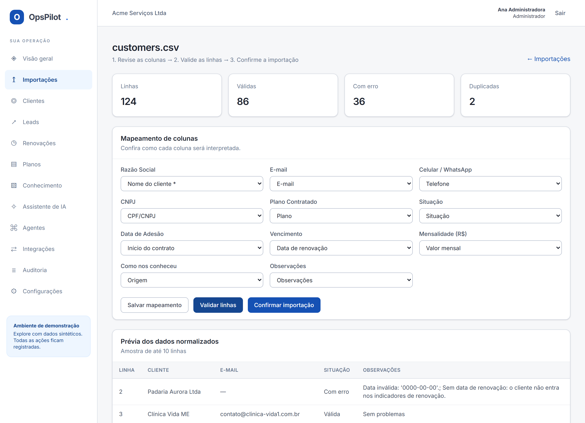
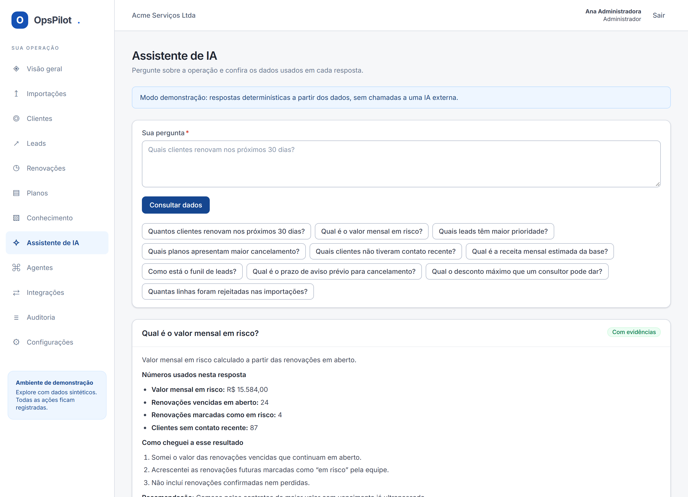

# OpsPilot — operações, dados e IA para pequenas empresas

### A planilha vira carteira de clientes. E cada número tem de onde veio.

Pequena empresa não perde cliente por falta de sistema caro — perde porque a informação está
em quatro planilhas com cabeçalhos diferentes e ninguém sabe quem vence semana que vem. O
OpsPilot ingere esses arquivos, **mostra linha por linha o que está errado antes de gravar**, e
responde perguntas sobre a operação citando o indicador que usou.

**Sobe com um comando** · **246 testes automatizados** · **Funciona sem nenhuma chave de IA**

> Projeto de portfólio de Danilo Evangelista. **Todos os dados são sintéticos** e o provider de
> IA padrão é um mock local determinístico — não é um modelo de linguagem externo.



---

## O problema que ele resolve

| Antes | Com o OpsPilot |
| :--- | :--- |
| Cada planilha chega com um cabeçalho (`Razão Social`, `cliente`, `nome fantasia`) | Mapeamento automático com grau de confiança, revisável antes de gravar |
| Importar é tudo-ou-nada: um campo ruim derruba o arquivo inteiro | 86 linhas entram, 36 ficam retidas **com o motivo de cada uma**, 2 duplicatas apontam a linha original |
| "Quanto temos em risco?" vira uma tarde de SOMASE | Pergunta em português, resposta com os números e a consulta que os produziu |
| Renovação descoberta depois do vencimento | Indicadores de 7 e 30 dias, atrasos e clientes sem contato recente |

## A importação é o coração do produto



A planilha de demonstração (`data/samples/customers.csv`) foi feita **imperfeita de propósito**:
datas `0000-00-00`, telefone sem DDD, e-mail sem domínio, `R$ 1.250,00` ao lado de `1250.00`,
CNPJ com e sem máscara e linhas repetidas plantadas. O relatório acima é o resultado real dela —
inclusive o detalhe de que uma linha repetida que já tinha erro é contada como erro, não como
duplicata, porque a deduplicação só avalia o que passou na validação.

O que acontece entre o upload e o banco:

1. **Detecção de formato** — delimitador e codificação do CSV descobertos por amostragem
   (`utf-8-sig`, `cp1252`, `latin-1`); XLSX pelo openpyxl, XLS pelo xlrd.
2. **Mapeamento sugerido** — cada cabeçalho é comparado com os sinônimos de 11 campos
   canônicos; a confiança vai junto, e **duas colunas nunca disputam o mesmo campo**.
3. **Normalização por campo** — telefone para E.164, e-mail minúsculo e validado, data
   aceitando `dd/mm/aaaa`, ISO e serial do Excel, dinheiro resolvendo a ambiguidade entre
   `1.234,56` e `1,234.56` pela posição do último separador.
4. **Validação que não para no primeiro erro** — a linha acumula todos os seus problemas, e a
   linha original é preservada com o número dela na planilha.
5. **Deduplicação com critério explícito** — a chave diz *por que* dois registros são o mesmo:
   `email:`, `doc:`, `phone+name:` ou `name:`, nessa ordem de confiança.
6. **Confirmação transacional** — cria clientes, planos e renovações, e grava a auditoria.

## O assistente responde com a conta na mão



A pergunta **não** vai direto para um modelo decidir o número. O caminho é determinístico:

```
pergunta → intenção (palavras-chave) → consulta SQL agregada → fatos com fonte
                                     → busca nos documentos indexados
                                     → o modelo apenas redige em cima disso
```

Sem fato e sem trecho de documento, a resposta é sempre a mesma frase — e o modelo nem chega a
ser chamado:

> Não encontrei evidências suficientes nos dados disponíveis.

É a diferença entre um assistente que erra com confiança e um que admite o limite. Há teste
automatizado para esse caso.

## Decisões que valem uma olhada no código

**O score de lead cabe em uma tabela, não em uma caixa-preta.** Sete critérios somando 100
pontos (contato 20, orçamento 18, segmento 15, recência 15, porte 12, interesse 10, origem 10).
A API devolve a pontuação **de cada critério** com a frase que a justifica. Quando a IA
classifica, o score por regras continua gravado ao lado — e o sistema registra se os dois
concordam. Em [`scoring.py`](backend/app/domains/leads/scoring.py).

**Busca documental sem depender de serviço externo.** PostgreSQL Full Text Search em português
com índice GIN de expressão. Nos testes, roda em SQLite por um fallback léxico com o mesmo
contrato — o trecho citado é escolhido pela janela que **cobre mais termos da pergunta**, não
pela primeira ocorrência, que costuma devolver o parágrafo errado.
Em [`search.py`](backend/app/domains/knowledge/search.py) e no [ADR 003](docs/adr/003-rag-fallback.md).

**Agente não é laço livre.** Cada agente declara as ferramentas que pode usar; o plano de
chamadas é determinístico, o limite de passos é obrigatório, e a execução inteira — ferramenta,
argumento, observação, duração — fica gravada em `agent_runs`. A única ferramenta de escrita
exige perfil ANALYST. Em [`runtime.py`](backend/app/domains/agents/runtime.py).

**O texto do modelo é dado, não marcação.** A resposta da IA vira elementos React, nunca
`dangerouslySetInnerHTML`. Tem teste provando que `` aparece como texto.

**Webhook que aguenta ser chamado duas vezes.** Assinatura HMAC-SHA256 sobre o corpo bruto,
comparada com `compare_digest`; chave de idempotência única por organização e direção. O
segundo envio responde `DUPLICATE` sem criar nada.

## Rodar

Requisitos: Git e Docker Desktop com containers Linux.

```bash
git clone https://github.com/danilogep/OpsPilot.git
cd OpsPilot
docker compose up --build -d
```

- Aplicação: <http://localhost:5173>
- API e documentação interativa: <http://localhost:8000/docs>
- Saúde do serviço: <http://localhost:8000/health>

O primeiro start aplica as migrations e cria a organização de demonstração com **100 clientes,
60 leads, 30 renovações, 5 planos e 10 documentos** sintéticos. Os volumes preservam banco e
uploads. **Nenhuma chave de API é necessária.**

| Conta local | Papel | Pode |
| :--- | :--- | :--- |
| admin@opspilot.local | Administrador | tudo, incluindo usuários e integrações |
| analyst@opspilot.local | Analista | importar, editar dados e usar a IA |
| viewer@opspilot.local | Visualizador | somente leitura (a API devolve 403 na escrita) |

Senha local: **`OpsPilot!2026`** — definível em `OPSPILOT_DEMO_PASSWORD` antes do primeiro seed.
O seed é idempotente e não redefine senha já existente.

Porta ocupada? Ajuste `BACKEND_PORT`, `FRONTEND_PORT`, `POSTGRES_PORT` e os respectivos
`VITE_API_BASE_URL` e `OPSPILOT_CORS_ORIGINS` num `.env`, partindo de `.env.example`. Mudança em
`VITE_API_BASE_URL` exige novo build do frontend.

## Roteiro de 5 minutos

1. Entre e veja os indicadores — todos calculados no banco, nenhum número fixo no código.
2. Em **Importações**, envie `data/samples/customers.csv`.
3. Confira o mapeamento sugerido, valide e abra as **36 linhas rejeitadas** com o motivo.
4. Confirme a importação e volte ao painel: os números mudaram.
5. Em **Leads**, abra um lead e veja o score critério a critério; peça a classificação por IA.
6. Em **Renovações**, gere o resumo executivo.
7. No **Assistente**, pergunte "Qual é o valor mensal em risco?" e confira as fontes.
8. Pergunte algo fora da base ("quem ganhou o mundial de 1998?") e veja a recusa.
9. Em **Auditoria**, encontre tudo o que você acabou de fazer.

## Stack

**Back-end** Python 3.12 · FastAPI · SQLAlchemy 2.0 assíncrono · Pydantic v2 · Alembic · PostgreSQL 16 · pandas
**Front-end** React 18 · TypeScript · Vite · Tailwind · TanStack Query · Recharts
**Qualidade** pytest · ruff · mypy strict · Vitest · Playwright · GitHub Actions
**Infra** Docker Compose · nginx · n8n (opcional)

```text
backend/           API, regras de negócio, migrations e testes
frontend/          aplicação React, componentes e testes de navegador
data/samples/      planilhas sintéticas, imperfeitas de propósito
integrations/n8n/  workflow de exemplo e contrato dos eventos
scripts/           comandos PowerShell/Bash, smoke test e geração de amostras
docs/              arquitetura, decisões (ADR), segurança e roteiro de demonstração
```

A API é modular por domínio: `api` (rotas) → `domains/<x>/service.py` (regra) → `db/models`
(persistência). Toda consulta de negócio passa por `organization_id`.

## Qualidade

| Suíte | O que cobre | Total |
| :--- | :--- | ---: |
| pytest | normalização, mapeamento, deduplicação, indicadores, score, mock, RAG, autorização, endpoints e importação de arquivo real | **228** |
| Vitest | componentes, formulários, estados de carregamento/erro, contrato HTTP e renderização segura da IA | **13** |
| Playwright | login → upload → validação → commit → painel → pergunta à IA; permissão do visualizador; navegação mobile | **5** |

```bash
cd backend && .venv/Scripts/python -m pytest        # 228 testes
.venv/Scripts/python -m ruff check . && .venv/Scripts/python -m mypy
cd ../frontend && npm run lint && npm run typecheck && npm run test:run && npm run build
npx playwright install chromium && npm run test:e2e  # precisa do ambiente no ar
```

Os testes de backend sobem **SQLite temporário** por padrão: quem clona roda a suíte sem
instalar banco. `OPSPILOT_TEST_DATABASE_URL` aponta para um PostgreSQL **dedicado e
descartável** (a suíte limpa todas as tabelas entre os testes).

Validação do ambiente em execução: `backend/.venv/Scripts/python scripts/smoke_test.py`.
As capturas deste README saem de `frontend/scripts/capture-screenshots.mjs`, que percorre o
fluxo real da aplicação — as telas mostram dados do banco, não maquete.

## IA real e automações

Padrão: `OPSPILOT_LLM_PROVIDER=mock`. O mock é determinístico, local e **não equivale a um LLM**:
ele redige a partir dos fatos já consultados, o que torna a demonstração reproduzível e de custo
zero. Os adapters de **Anthropic, OpenAI e Gemini** estão implementados — configure
`OPSPILOT_LLM_PROVIDER`, `OPSPILOT_LLM_MODEL` e a chave no `.env` e recrie o backend. Uso real
exige credencial válida e validação com o provedor; os custos exibidos são estimativa.

n8n é opcional: `docker compose --profile automation up -d`. Entrada (`lead.created`,
`renewal.updated`) e saída (`import.completed`, `lead.classified`) com HMAC e idempotência.
Contrato, payloads e workflow em [integrations/n8n](integrations/n8n/README.md).

## Documentação

- [Arquitetura](docs/architecture.md) — diagrama e fluxos
- [API](docs/api.md) — rotas, paginação e formato de erro
- [Dicionário de dados](docs/data-dictionary.md) — entidades e como cada número é apurado
- [Segurança e limites](docs/security.md) — o que está feito e o que falta para produção
- [Demonstração](docs/demo.md) — roteiro e textos de apresentação
- [Validação](docs/validation.md) — resultado da última execução completa
- [ADRs](docs/adr) — arquitetura, provider de IA, RAG, score, webhooks e testes

## Limites — o que este projeto não é

- O provider padrão é um **mock local**, não um modelo de linguagem.
- Importação **síncrona**, adequada a arquivos pequenos; não há fila distribuída.
- PDF digitalizado **não tem OCR**: sem texto selecionável, o documento é recusado.
- O JWT fica em `localStorage`; uma falha de XSS comprometeria a sessão. Cookie `HttpOnly` com
  CSRF é a evolução indicada.
- O isolamento por organização é feito nos serviços; um SaaS público multiempresa pede RLS no
  PostgreSQL e testes de isolamento dedicados.
- O gráfico mostra novos contratos por mês de início — não é histórico contábil.
- **Não auditado para uso público.** É um sistema demonstrativo.

## Roadmap

Itens **não implementados**, na ordem de custo versus ganho percebido por uma pequena empresa.

| Evolução | O que muda | Pré-requisito |
| :--- | :--- | :--- |
| Fila de processamento (Redis + worker) | importar planilhas grandes sem bloquear a requisição | serviço Redis e worker separado |
| Alertas por e-mail | aviso automático de renovação e inadimplência | provedor SMTP e política de opt-out |
| Google Sheets | ler a planilha direto da conta do cliente | OAuth do Google e consentimento |
| WhatsApp e Telegram | enviar as mensagens hoje apenas sugeridas | API oficial, modelos aprovados e trilha de consentimento |
| CRM (HubSpot, Pipedrive, RD Station) | sincronizar leads nos dois sentidos | mapeamento de campos e resolução de conflito |
| Pagamentos (Pix, assinatura recorrente) | conciliar cobrança com renovação | provedor de pagamento e reconciliação |
| Power BI / exportação analítica | levar os indicadores ao BI da empresa | endpoint OData ou dataset agendado |
| Embeddings na base de conhecimento | busca semântica somada à textual | provider de embeddings e pgvector |
| OCR em PDF digitalizado | indexar documento sem texto selecionável | motor de OCR e revisão de qualidade |
| Multi-tenant avançado | isolamento no banco com RLS e limite por organização | migração de políticas e testes de isolamento |
| Deploy em nuvem | ambiente público com TLS, backup e observabilidade | infraestrutura, domínio e rotina de restauração |

## Desenvolvimento sem Docker

Dois terminais. Primeiro o backend:

```powershell
cd backend
py -3.12 -m venv .venv
.\.venv\Scripts\python -m pip install -e ".[dev]"
$env:OPSPILOT_DATABASE_URL = 'sqlite+aiosqlite:///./opspilot.db'
.\.venv\Scripts\python -m alembic upgrade head
.\.venv\Scripts\python scripts_seed.py
.\.venv\Scripts\python -m uvicorn app.main:app --port 8000
```

Depois o frontend:

```powershell
cd frontend
npm ci
npm run dev
```

No Linux use `python3.12`, `.venv/bin/python` e
`export OPSPILOT_DATABASE_URL=sqlite+aiosqlite:///./opspilot.db`. SQLite é conveniência local;
o Docker usa PostgreSQL.

---

<div align="center">

**Danilo Evangelista** · Back-end Python/FastAPI, dados e aplicações com IA

[](https://linkedin.com/in/danilogep)
[](mailto:danilo.gep@gmail.com)

Licença [MIT](LICENSE)

</div>
