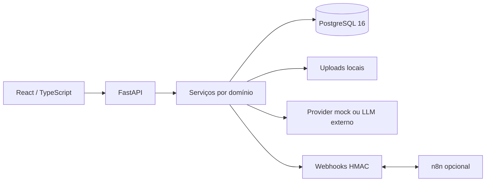

# Arquitetura

Monorepositório com backend e frontend independentes. Rotas validam entrada e autorização; serviços fazem consultas limitadas à organização. Modelos SQLAlchemy e migrations definem persistência. Pydantic define os contratos; frontend contém tipos correspondentes.

Importação: upload → proposta de mapeamento → revisão → normalização/validação → confirmação transacional → auditoria/evento.
Busca: extração de texto → blocos → PostgreSQL full text search em português → seleção de trechos → resposta com fonte. Em SQLite há fallback lexical com contrato comum, mas rankings podem diferir.
Agentes: seleção explícita de ferramentas, limite de passos e execução registrada. Não são agentes autônomos navegando na internet.
Interface: sessão validada via API, TanStack Query para consultas/invalidação, permissões também no backend.
